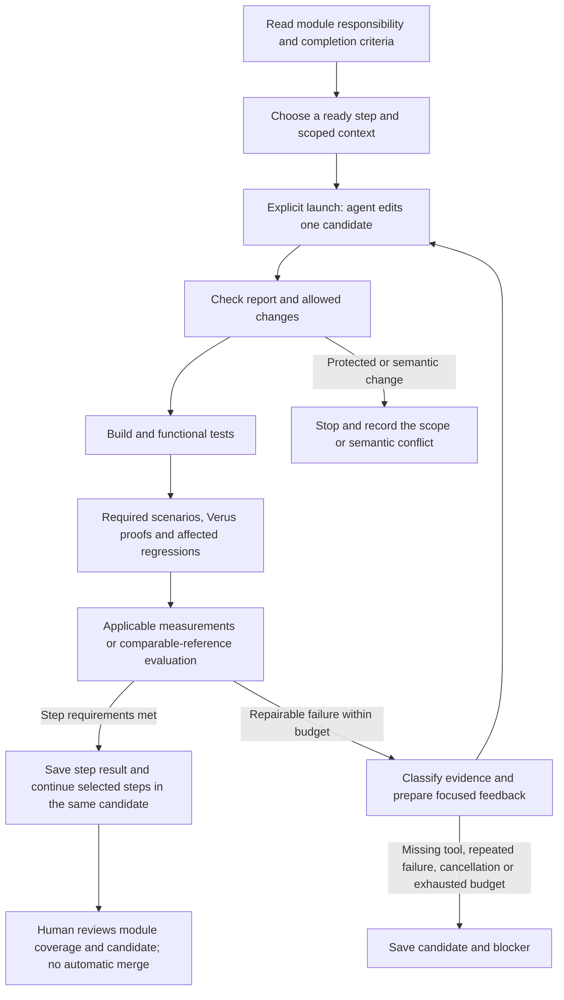

# Developing Raft modules through checked steps

Status: DRAFT. Local checks may run on draft code. The requested experiment is configured, but actual generation requires an explicit launch; human review follows code delivery. No live generation was used for this revision. Task completion, specification approval and complete-project acceptance are separate facts.

## Choose a module and a bounded step

Read `input/roadmap.md`, then the relevant module assignment: `state.md`, `runtime.md`, `elections.md`, `replication.md`, `commitment.md`, `recovery.md`, `progress.md` or `integration.md`. Each describes the complete module, its connections and completion criteria. Internal steps provide bounded implementation/proof/test work. Reusable event handlers must cover arbitrary inputs satisfying their contracts and compose across repeated events; one scripted successful exchange is insufficient.

`workflow.toml` selects the module document and exact `## Step: ...` heading through `module` and `step`, plus dependencies, context, editable paths, checks and budgets. Common module context goes before the first step; each step uses `###` subheadings. The controller supplies that common context and only the selected step body. Missing, duplicate or empty step headings are configuration errors. Ordinary repairs cannot change their module requirements or independently selected checks. Legacy standalone Markdown loading remains for existing controller clients/fixtures; the repository's old T files have been removed.

Formal definitions and proofs live in Verus source. The existing global proof checklist remains in `input/proofs.md`; the bounded local reconciliation, initialization, persistence and progress targets close none of the 26 global obligations.

From the repository root, these commands inspect work without starting an agent:

```sh
export PYTHONDONTWRITEBYTECODE=1
python3 -m orchestrator validate
python3 -m orchestrator plan --format text
python3 -m orchestrator prompt --task MADRAFT-VOTE
python3 -m orchestrator run-task --task MADRAFT-VOTE --dry-run
python3 -m orchestrator run-plan --tasks MADRAFT-RECOVERY --dry-run
```

Ready means the task has a usable scope and local checks; it does not start generation automatically. Planned tasks identify missing node/coordinator/proof prerequisites and have no pretend successful check. Implementation-layer contracts, representation/view changes, helper lemmas and invariants are normal scoped development. Independent behavioral requirements remain protected. Changed public behavior, assumptions, top-level properties, trusted interfaces or acceptance rules need an explicit explanation for human review.

## New run versus resume

Every explicit new launch creates a unique evidence/runs/RUN_ID/candidate from the supplied MadRaft-inspired foundation, with fresh budgets and empty attempt history. It never starts from another experiment's candidate or last success. Only explicit resume reuses an existing candidate and cumulative accounting. Within a run, steps and repairs share code and proofs. The controller never writes that generated result back to the supplied source checkout automatically.

Evidence is output rather than input. Obsolete maintenance archives were deleted, not moved elsewhere. Current calibration and maintenance check logs remain small; compiled build directories are disposable. Each run's raw diagnostics remain available while that run is being investigated. Deliberately deleting a completed run also removes the ability to resume it; the workflow does not silently delete or auto-resume old experiments.

## The serial development loop

Module boundaries organize work; the runtime is a coupled state machine. Shared term/role, log, peer progress, commit/delivery positions and pending I/O constrain each other across successive events. A higher-term message, replacement of a log suffix or recovery can affect several handlers. Read connected contracts and establish caller preconditions; rerun affected cross-module scenarios and proofs. The common invariant and node/cluster refinement connect local arguments. Neither separate module passes nor the development dependency DAG proves this composition.



The controller reuses its candidate copy, subprocess runner, independent checks and bounded retry loop. It never copies a successful candidate back into the user's source tree automatically. One candidate remains unchanged while its independent check group runs. Cancellation, timeouts and log limits terminate the controlled POSIX process group; persistent failing targets trigger bounded redesign and then stop at the cumulative limit; changing bytes alone does not count as progress. Proof and benchmark tasks retain their configured time budgets. Linux/POSIX and Python 3.10+ are supported.

`run-plan` continues dependency-ready steps in one saved candidate. Its PASSED result means only the selected steps passed their checks: `completion_scope` is `SELECTED_STEPS_ONLY`, `module_completion` is `NOT_ASSESSED`, and `full_acceptance` remains false. Neither initialization nor the optional helper steps complete a module or Raft. Review module completion against its entire behavior and actual integration/proof coverage; no new automated module approval is introduced.

`resume` preserves the candidate, checks current prerequisites and input bindings, and reruns stale checks before reusing results. An implementation or checker change invalidates affected evidence. Unrelated explanatory prose does not require working protocol code to be generated again. The saved run ID identifies the plan; `report --run-id RUN_ID` reads its records. Old runs with removed IDs are not silently remapped or granted permission under new scopes. `plan` still defaults to machine-readable JSON; `plan --format text` is the readable module/step view. A stopped plan is not a source merge.

## Configured Sol/High experiment

`workflow.toml` selects `gpt-6.1-sol` and `model_reasoning_effort = "high"`. The existing `allow_real_codex` switch is true for this local experiment. Generation requires an explicit `--execute-codex` launch. Start and resume need no approval file, signature or in-process human checkpoint. Preview is the launcher's default. Review the delivered code and results together afterward. No background job, scheduled run, merge or publication is configured.

```sh
./experiment.sh                 # Preview, no generation
./experiment.sh run             # Generate missing protocol code and local proofs in one candidate
./experiment.sh resume RUN_ID   # Reuse the same candidate and recheck stale results
./experiment.sh report RUN_ID   # Read results without generation
```

The launcher works from any current directory and selects MADRAFT-RECOVERY, expanding STATE-INIT, RUNTIME-PERSIST and the four MadSim protocol steps in dependency order. Each task allows three calls, at most two repairs, 600 seconds per call and 2,400 seconds total; resume does not reset these budgets. The supplied inputs are the host, interfaces, independent requirements and protocol scaffold. Python-launched Codex generates initialization, persistence, voting and the remaining behavior, representation, local predicates and proofs, using protected tests and same-source proof callers for feedback.

The independent local barrier checks actual `handle_event`; functional checks demand useful progress, and completed tasks are rechecked. Selected-step completion is not a global safety result. Complete-execution correspondence and five-property consumers are still missing, so raft-safety remains BLOCKED and INTEGRATION-SAFETY remains planned. Conditional liveness is a required experiment objective with incomplete global checking.

```sh
python3 -m orchestrator run-plan --tasks MADRAFT-RECOVERY --execute-codex
python3 -m orchestrator resume --run-id RUN_ID --execute-codex
```

Original initialization, persistence and reconciliation demonstrations remain explicitly selectable offline regression examples. Their fixtures simulate generation and are never supplied to real candidates. `Agent.md`, local metadata, the maintenance review packet, evidence and the entire `orchestrator/tests` directory are excluded from candidate copies. This prevents accidental answer inclusion, not malicious access by a same-user process.

The retry prompt retains prior attempt summaries (explicitly agent claims), changed files, independent outcomes and links to saved patches/raw diagnostics. Detailed repair context is included for failed checks. The existing call budget bounds history; no new agent hierarchy, score system or evidence format is needed. Within scope, change code, local contracts, representation and invariants together. Report these ordinary edits in `changed_files` and `summary`; `proposed_spec_changes` is reserved for changes to protected behavioral requirements or assumptions and stops ordinary repair for review.

Existing `input_bindings.json` records detect source/checker changes and stale evidence within retained experiments. Candidate separation, edit scope, independent checks, process limits and sandbox settings remain. Review follows delivery, with no approval file inside the loop; passing checks neither approves DRAFT semantics nor merges code. Hostile same-user process isolation remains unimplemented.

Global controller options go before the subcommand and override project settings for that invocation. For example:

```sh
python3 -m orchestrator --model gpt-6.1-sol --reasoning-effort high run-plan --dry-run
```

The subprocess receives `--model gpt-6.1-sol --config 'model_reasoning_effort="high"'`. Plan/task records report requested settings separately from the resolved service model (currently unknown). Model access and supported effort depend on the client account; errors do not trigger substitution. No live access check has been made. The user's global Codex settings and system Rust toolchain are untouched.

The syntax was checked against installed `codex exec --help` and official OpenAI [CLI overrides](https://learn.chatgpt.com/docs/config-file/config-advanced#one-off-overrides-from-the-cli) and [model/reasoning settings](https://learn.chatgpt.com/docs/config-file/config-sample).

## Run and interpret independent checks

```sh
python3 -m unittest discover -s orchestrator/tests -v
python3 -m orchestrator verify --profile interface-check
python3 -m orchestrator verify --profile reconcile-tests
python3 -m orchestrator verify --profile spec
python3 -m orchestrator verify --profile reconcile-proof
python3 -m orchestrator verify --profile reconcile-replay
python3 -m orchestrator verify --profile reconcile-bench
python3 -m orchestrator verify --profile full
```

| Purpose / profile | What the result establishes |
|---|---|
| Build / `interface-check` | The selected Rust library compiles; no theorem |
| Typecheck / `spec` | Verus accepts model types/modes; `TYPECHECKED` discharges no obligation |
| Test / `reconcile-tests` | Actual nonempty functional regressions pass against the shared operation |
| Test / `reconcile-replay` | A deterministic local operation trace meets its assertions; no full network/crash coverage |
| Proof / `reconcile-proof` | Actual Verus checks the executable operation and configured local correspondence entrypoint; only `LOCAL-RECONCILE` |
| Benchmark / `reconcile-bench` | `MEASURED` records repeated core-operation data; without an approved reference/threshold, performance verdict is inconclusive |
| Policy review | Records a required review condition; it cannot create human approval |
| Proof / `full` | Requires complete approved final-candidate coverage, including safety, liveness, I/O and executable progress refinement; currently incomplete |

A test-only or benchmark-only task needs no proof target. A typecheck-only task can complete its stated goal. Typechecking alongside a successful actual proof does not block local completion. A proof task must check its actual entrypoint and obligations: aggregate counts, names in source and unrelated smoke lemmas are insufficient. Missing required checks, zero selected tests, absent proof entrypoints and missing tools never count as success. An optional benchmark can report no verdict; a task requiring measurements is incomplete if the data is missing.

The agent report is only a claim. Commands, expectations and existing oracles come from protected configuration and files outside ordinary repair scope. New tests and checker changes are separate, reviewed development work. Simulated subprocesses cannot close real Raft obligations. In the repair demonstration, candidate patches are scripted while Rust/Verus checks are real; evidence records these two provenances separately. `smoke-positive` and `smoke-negative` calibrate the verifier and close no Raft obligation. Negative verification succeeds only for the expected proof failure, not a compiler error or missing tool.

### Shared runtime and Verus source

`crates/raft-verified/src/reconcile.rs` contains the `reconcile_log` interface and source contract with an intentionally incomplete body. The experiment supplies the executable logic and local proof blocks. The protected view in `crates/raft-spec/src/reconcile_view.rs` preserves entry contents. The protected `crates/raft-proofs/reconcile.rs` caller independently requires the full original postcondition, so an editable implementation cannot pass by weakening its contract. Additional proved corollaries live in the separately editable `reconcile_lemmas.rs`. The ordinary library reexports that operation; Rust integration tests, the replay example and the measurement example call it. `crates/raft-proofs/reconcile.rs` imports the same source and the candidate model's `merged` relation. There is no separately maintained verification-only algorithm.

`crates/raft-verified/check.py` uses the installed Verus release's `libvstd.rlib` and macro dependencies with its matching Rust 1.92 toolchain in the child process. Cargo's Verus macro expansion erases ghost/proof syntax from the shared source; the Verus entrypoint checks that source with proofs retained. The wrapper configures `RUSTC` and library search paths locally, without changing the user's default toolchain or downloading tools. Missing installation files produce an explicit blocker. See `docs/tools.md` for installation provenance.

Direct commands use the same wrapper as the independent profiles:

```sh
python3 crates/raft-verified/check.py build
python3 crates/raft-verified/check.py test
python3 crates/raft-verified/check.py proof
python3 crates/raft-verified/check.py replay
python3 crates/raft-verified/check.py bench
```

The replay is a local sequence of reconciliation calls, with seed, explicit trace and relevant before/after log states. The measurement is a core microbenchmark across several log lengths. It records repetitions, raw samples, code version/binding, build mode, workload, command/batch size, concurrency, machine and timing boundary. Run it without competing heavy jobs. No approved throughput target or regression percentage exists. The MadSim host now supplies network/storage adapters and repeatable fault scenarios. Missing protocol behavior prevents successful full-cluster execution; cluster performance measurements and universal proofs remain future work.

## Read failures before repairing

Every focused repair request includes the task goal, candidate revision, failed argv, expected and observed behavior, a relevant English excerpt, reproduction command, full artifact paths, editable scope and required reruns. Full raw logs are preserved unchanged. Non-English raw logs are not supplied to an LLM; an English explanation is labeled and points to the original. Diagnosis remains provisional.

| Observation | Feedback and next action |
|---|---|
| Build or functional failure | Reproduce the failing input; retain a regression; repair the cause within scope |
| Local fault/scenario failure | Include seed, explicit trace and states; inspect the core, adapter and oracle before attributing blame |
| Candidate syntax, types, modes or visibility error | Repair source; proof is NOT_RUN, not a missing-tool blocker or successful negative proof |
| Unproved Verus goal | Include symbol/obligation, source context and definitions; investigate code, missing invariant, specification or solver/resource limits; failure to prove is not itself a counterexample |
| Missing tool, unsupported interface or infrastructure timeout | Repair configuration in an authorized scope or record BLOCKED; do not modify Raft semantics |
| Suspected performance regression | Include workload/reference and repeated samples; repeat comparable runs and report noise/inconclusive data before optimizing |
| Requirement/model conflict or protected checker edit | Save the discrepancy and proposed change; stop ordinary repair for human review |

## Recheck affected work and preserve boundaries

| Changed material | Required response |
|---|---|
| Executable core, representation or local contracts | Related functional/scenario tests, correspondence and dependent proofs; measurement when the measured path changes |
| Proof-only source | Affected proofs and dependent theorems; establish that executable behavior is unchanged before skipping runtime measurement |
| Protected behavioral requirement, public observable interface or assumptions | Explicit semantic review and dependent implementation/model checks |
| Scenario oracle, benchmark harness or checker | Explicit checking-policy review, then recheck affected candidates |
| Explanatory documentation only | References and prompt checks; no automatic protocol regeneration |

Existing evidence content bindings prevent reuse of a pass after uncommitted implementation or checking-policy changes. Git does not bind uncommitted/external inputs; versions and primary keys do not identify their contents; transactions/uniqueness do not cover file trees and subprocesses; types and ordinary tests cannot establish exactly which bytes were checked. This revision reuses those narrowly required bindings. It adds no new hash protocol, frozen contract, baseline or general-purpose gate.

Snapshots cover untracked files, deletions, modes, directories and links. Candidate creation rejects symlinks/special files; path checks reject escaping or unauthorized changes. Source is never reset or cleaned. Read-only `.git`, `.agents`, `.codex` and `.aws` remain untouched. Trust scanning flags possible assumptions, external bodies, unsafe code and unfinished verification; it is a diagnostic scan, not a proof that no hidden axiom exists.

Evidence uses restricted file permissions and retains bounded full process logs. The trusted local host and toolchain remain part of the declared boundary; same-user tampering, all path races and malicious subprocess escape are not solved by directory copies. Authentication, data security, irreversible actions and publication keep their existing protections. Stop with the human review packet; do not recursively invoke Codex, approve semantics, merge, push or publish automatically.

## Continue, redesign and repair regressions

The generated plan state now owns per-task and total calls, repair/redesign counts, active execution seconds, attempt references, diagnostics and scoped checkpoints. A call is charged before launch. Its bounded time reservation is refunded to actual elapsed process time after a normal return; interruption before settlement conservatively consumes the whole reservation. Independent checks use the same time accounting. Paused wall time is not charged, and no process-local monotonic timestamp survives a restart. Current-invocation deadlines also bound preparation/checking; historical runs without this accounting cannot acquire a fresh allowance by resuming. Plan caps default to the sum of selected step caps; optional `plan_budget.max_agent_calls` and `plan_budget.active_seconds` can lower them.

Failed checks and agent design explanations persist separately. Each attempt retains both its change from the previous candidate (`attempt.patch`) and the cumulative source comparison (`candidate.patch`). `stalled_attempts` counts repeated blocking targets, not source hashes; removing a failing target can reset it, and a changed blocking target starts a new count. With `max_redesigns = 1`, a stalled attempt receives a different prompt through the same adapter: suspected cause, abandoned representation/invariant, revised design and first obligation/check. The design is an agent hypothesis. A solver timeout is inconclusive and gets bounded proof-complexity investigation at the same limit; missing tools, invalid reports and authentication failures stop. Targets and assumptions cannot be weakened during repair.

A conservative check dependency rule reruns all already completed selected tasks with the current task. Shared implementation/proof edits are allowed only in the union of those tasks' authorized scopes; tests, behavioral targets and policy stay protected; scoped implementation-layer specifications remain editable. All affected correctness checks precede any measurement. A failure immediately invalidates earlier results and is routed to the current change, including after interruption, instead of regenerating the old assignment. Source scope conflicts remain blockers for delivery-time review.

Each successful check saves an editable-file checkpoint labeled with that check's scope and PASS or TYPECHECKED result. A test checkpoint does not claim proof completion. `rewind` changes only the saved candidate, retains the abandoned patch, invalidates completion records and reruns affected checks before resume revalidates task completion. It neither resets the checkout nor adds budget. These explicit commands never launch an agent:

```sh
python3 -m orchestrator extend-plan --run-id RUN_ID --task RUNTIME-PERSIST --calls 1 --repairs 1 --seconds 600
python3 -m orchestrator rewind --run-id RUN_ID --task RUNTIME-PERSIST --check persist-tests
python3 -m orchestrator report --run-id RUN_ID
```

`--redesigns 1` can explicitly extend that separate allowance when needed. Extensions are recorded in the same plan state, not approval files. A subsequent `resume --run-id RUN_ID --execute-codex` is a separate explicit launch. Generation provenance is retained per attempt; a plan with scripted and real calls reports MIXED. Check provenance remains separate, and simulated checking never closes a real obligation.

## Optional performance feedback

Without an explicit comparison rule, benchmark results stay MEASURED/INCONCLUSIVE. A benchmark profile may add a `comparison` table with `reference_path` (saved measurement JSON or a check report), `reference_candidate`, `max_regression_fraction`, `max_relative_dispersion`, `minimum_samples`, `workload_fields` and `comparable_fields`. There is no configured threshold in this repository. Choose a rule deliberately; do not infer one from the current microbenchmark numbers. Declare workload dimensions such as log length, command size, batch size and concurrency so repeated workload names are unique. Build mode, environment, measurement boundary and units must agree; missing or mismatched workloads are rejected.

The comparison reports medians, sample counts, relative ranges and ratios. A regression requires enough stable repeated samples and every candidate sample to exceed the reference range by the configured fraction; noise or too few samples is INCONCLUSIVE. Only a reproduced regression routes to bounded profiling/optimization. Any patch then goes through all affected tests, proofs and scenarios before measurement is eligible again. Checks and measurements run serially in this runner; the operator must keep other heavy jobs off the measured resource. Deterministic comparison fixtures test this routing and are labeled SIMULATED, separately from actual release microbenchmarks. Real cluster committed/delivered throughput, latency and recovery measurements remain the later integration assignment.
