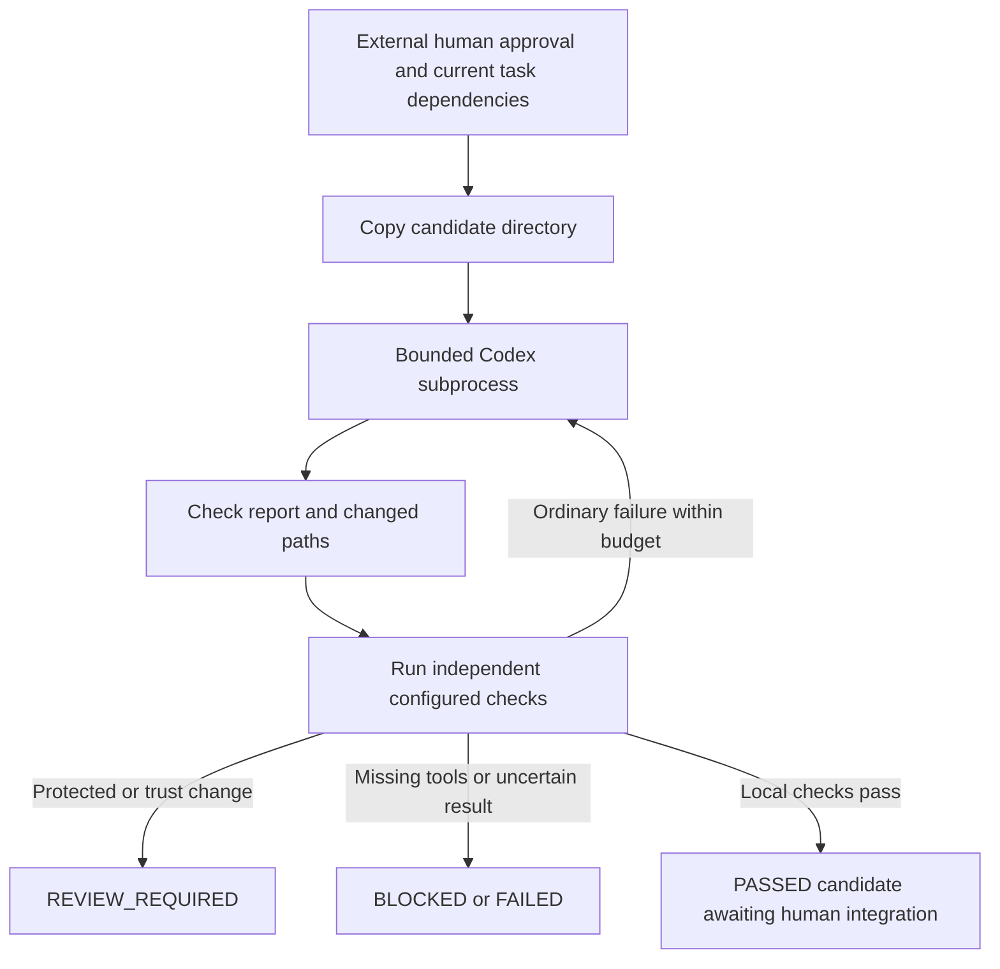

# Python workflow

Status: DRAFT. Bootstrap launches no real Codex generation. All LLM instructions, tasks, reference documents, source comments and repair feedback must be English. Preserve raw evidence unchanged; non-English raw logs are not forwarded as prompt material.

## Authoring

Maintain topic-specific Markdown in `input/` and execution settings in `workflow.toml`. Python modules live directly in `orchestrator/`; run `python3 -m orchestrator` from the repository root without setting PYTHONPATH. Each task has one Markdown file; its TOML entry supplies dependencies, editable paths, outputs, obligation IDs and checks. The controller reads the obligation/coverage tables directly from `input/proofs.md`; there is no duplicate JSON registry. Lists in table cells use commas and `-` for an empty list.

The prompt combines `input/instructions.md`, the task Markdown and plain-text context/edit/check lists. Repair prompts append actual independent diagnostics. `python3 -m orchestrator prompt --task T01-MODEL` displays this without launching anything. Agent reports and external approvals still use the small schemas packaged under `orchestrator/wire/`; these are runtime protocols, not daily authoring formats.

## Execution



The controller is serial: `plan` lists dependency order; each task needs an explicit invocation. States include PENDING, READY, RUNNING, CHECKING, NEEDS_REPAIR, PASSED, FAILED, BLOCKED, REVIEW_REQUIRED and CANCELLED. It never automatically merges a candidate. A repeated identical failure stops retries; repairs cannot expand editable paths. Full Raft acceptance always remains false in this bootstrap.

`codex_runner.py` checks installed version/help before using `codex exec`. Arguments are an argv list, prompts use stdin and final reports are separate from stdout JSONL. Unknown events are retained with warnings; malformed/missing reports and nonzero exits cannot establish success. The existing user model is used unless configured; unknown model usage/cost is not invented.

`process.py` concurrently drains stdout/stderr and enforces call, repair, time and log-size budgets. Cancellation/timeout/log overflow terminates the controlled POSIX process group, including ordinary descendants. Malicious `setsid` escape is outside this mechanism. There is no automatic network access, installation, login or sandbox expansion.

## Independent checking

Only protected configuration selects verifier commands. The agent's report is a claim, never verification evidence. Existing safety checks remain:

- Reject missing targets, wrong tool versions, invalid reports, nonzero unexpected exits and uncertain results.
- Label fake fixtures SIMULATED; they cannot satisfy real dependencies or close Raft obligations.
- Keep Cargo builds, model TYPECHECKED, smoke proofs and Raft proofs distinct. Zero verified results never close proof tasks.
- Check declared obligations, transitive dependencies, assumptions, TCB and source references. Safety cannot inherit liveness premises; completed-proof ingestion is not implemented.
- Require coverage of all task obligations before real local success. The full profile remains blocked by missing implementation/proofs and formal isolation.

The real Verus adapter uses calibration from recorded positive/negative checks and the exact observed version/output format. Aggregate counts alone do not establish per-symbol coverage. Current `spec` is only a typecheck; it cannot complete T01's proof obligations. Later tasks still need reviewed local proof entrypoints and completion criteria. See [tool setup and actual historical checks](tools.md).

## Approval and source protection

Real execution is disabled by default. Future invocation, after human review:

```sh
python3 -m orchestrator run-task --task APPROVED_TASK --execute-codex \
  --approval-file /outside-agent-workspace/approval.json
```

Approval must be outside source/candidate, identify the human reviewer and timezone-aware approval time, cover the task scope and match current protected content, checking policy, toolchain and trust declarations. The [packaged example](../orchestrator/wire/approval.example.json) is deliberately invalid. There is no self-approval command. Digests are computed by the controller; task authors do not fill in hashes or approve DRAFT materials.

Existing content bindings prevent reuse of a PASS after changing uncommitted source or the checking policy. Git omits uncommitted/external inputs; versions and primary keys do not bind bytes; database transactions/uniqueness do not cover file trees and subprocesses; types and ordinary tests cannot identify which exact content was approved and checked. This refactor reuses that protection and adds no new hash protocol, frozen contract, baseline or gate. Changed paths/materials invalidate old approval/evidence bindings.

Snapshots include untracked files, deletions, modes, directories and links. Candidate creation rejects symlinks/special files. Change checks reject escaping paths, unauthorized edits and new links; `.agent-output` permits only its report. Source is never reset or cleaned by the workflow. Root controller evidence, Git metadata and build outputs are excluded from candidate source; nested directories with those names are still checked. Passing candidates require human integration and current dependency evidence.

Trust scanning masks comments/strings and flags possible assumption, external, unsafe, unfinished and conditional-compilation changes. It is not a Rust parser and cannot establish the absence of hidden axioms. Such changes require review.

## Limits

Local directory copies and digests do not resist a hostile process with the same user permissions, modify-then-restore attacks or all path-replacement races. Formal execution needs external permission isolation of candidate, checker, tools, approval and evidence. Non-local isolation settings remain BLOCKED until implemented.

Evidence directories/logs use 0700/0600. Full environments and authentication files are not recorded. Verifiers inherit a restricted set of environment variables, but HOME can still expose secrets; a trusted local host is required. Human redaction is needed before sharing raw logs publicly. The checker itself remains DRAFT and cannot approve itself. Authentication, irreversible actions and publication retain project review requirements.
