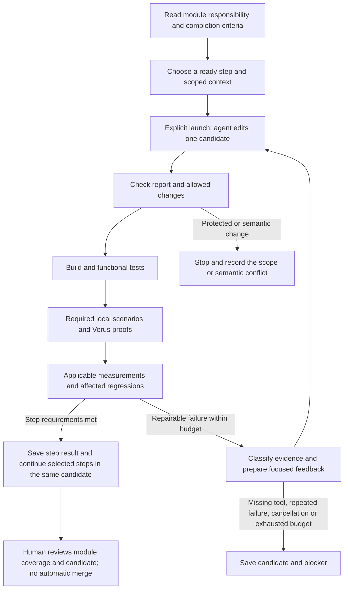

# Developing Raft modules through checked steps

Status: DRAFT. Local checks may run on draft code. The requested experiment is configured, but actual generation requires an explicit launch; human review follows code delivery. No live generation was used for this revision. Task completion, specification approval and complete-project acceptance are separate facts.

## Choose a module and a bounded step

Read `input/roadmap.md`, then the relevant module assignment: `state.md`, `runtime.md`, `elections.md`, `replication.md`, `commitment.md`, `recovery.md`, `progress.md` or `integration.md`. Each describes the complete module, its connections and completion criteria. Internal steps provide bounded implementation/proof/test work. Reusable event handlers must cover arbitrary inputs satisfying their contracts and compose across repeated events; one scripted successful exchange is insufficient.

`workflow.toml` selects the module document and exact `## Step: ...` heading through `module` and `step`, plus dependencies, context, editable paths, checks and budgets. Common module context goes before the first step; each step uses `###` subheadings. The controller supplies that common context and only the selected step body. Missing, duplicate or empty step headings are configuration errors. Ordinary repairs cannot change their module requirements or independently selected checks. Legacy standalone Markdown loading remains for existing controller clients/fixtures; the repository's old T files have been removed.

Formal definitions and proofs live in Verus source. The existing global proof checklist remains in `input/proofs.md`; the bounded `LOCAL-RECONCILE` and `LOCAL-NODE-INIT` targets close none of the 26 global obligations. The roadmap maps the old task IDs to current module steps; saved historical evidence retains its original IDs.

From the repository root, these commands inspect work without starting an agent:

```sh
export PYTHONDONTWRITEBYTECODE=1
python3 -m orchestrator validate
python3 -m orchestrator plan --format text
python3 -m orchestrator prompt --task STATE-INIT
python3 -m orchestrator run-task --task STATE-INIT --dry-run
python3 -m orchestrator run-plan --tasks STATE-INIT --dry-run
```

Ready means the task has a usable scope and local checks; it does not start generation automatically. Planned tasks identify missing node/coordinator/proof prerequisites and have no pretend successful check. New proved helper lemmas and invariants are normal proof development. Changed public behavior, assumptions, top-level properties, trusted interfaces or acceptance rules need an explicit explanation for human review.

## The serial development loop

Module boundaries organize work; the runtime is a coupled state machine. Shared term/role, log, peer progress, commit/delivery positions and pending I/O constrain each other across successive events. A higher-term message, replacement of a log suffix or recovery can affect several handlers. Read connected contracts and establish caller preconditions; rerun affected cross-module scenarios and proofs. The common invariant and node/cluster refinement connect local arguments. Neither separate module passes nor the development dependency DAG proves this composition.



The controller reuses its candidate copy, subprocess runner, independent checks and bounded retry loop. It never copies a successful candidate back into the user's source tree automatically. One candidate remains unchanged while its independent check group runs. Cancellation, timeouts and log limits terminate the controlled POSIX process group; repeated failure without useful changes stops repair. Proof and benchmark tasks have their own larger time budgets. Linux/POSIX and Python 3.10+ are supported.

`run-plan` continues dependency-ready steps in one saved candidate. Its PASSED result means only the selected steps passed their checks: `completion_scope` is `SELECTED_STEPS_ONLY`, `module_completion` is `NOT_ASSESSED`, and `full_acceptance` remains false. Neither initialization nor the optional helper steps complete a module or Raft. Review module completion against its entire behavior and actual integration/proof coverage; no new automated module approval is introduced.

`resume` preserves the candidate, checks current prerequisites and input bindings, and reruns stale checks before reusing results. An implementation or checker change invalidates affected evidence. Unrelated explanatory prose does not require working protocol code to be generated again. The saved run ID identifies the plan; `report --run-id RUN_ID` reads its records. Old runs with removed IDs are not silently remapped or granted permission under new scopes. `plan` still defaults to machine-readable JSON; `plan --format text` is the readable module/step view. A stopped plan is not a source merge.

## Configured Sol/High experiment

`workflow.toml` selects `gpt-6.1-sol` and `model_reasoning_effort = "high"`. The existing `allow_real_codex` switch is true for this local experiment. Generation requires an explicit `--execute-codex` launch. Start and resume need no approval file, signature or in-process human checkpoint. Preview is the launcher's default. Review the delivered code and results together afterward. No background job, scheduled run, merge or publication is configured.

```sh
./experiment.sh                 # Preview, no generation
./experiment.sh run             # Generate and prove node initialization
./experiment.sh resume RUN_ID   # Reuse the same candidate and recheck stale results
./experiment.sh report RUN_ID   # Read results without generation
```

The launcher works from any current directory and selects STATE-INIT. It allows three agent calls, at most two repair rounds, 600 seconds per call and 2,400 seconds for the task. This is a bounded generation experiment, not the entire Raft project. The checked source seed intentionally rejects all memberships; the agent must implement the constructor and its proof together. Eight independent tests and a protected Verus caller prevent reject-all or weakened-contract acceptance. Ordinary repairs may edit only `crates/raft-verified/src/node.rs`.

The task runs build, all 23 runtime regressions, initial-state replay, model typechecking, the local initialization proof and existing reconciliation proof. Only after those pass does it measure constructor cost. TYPECHECKED is useful feedback but closes no obligation. A pass closes only the mapped local targets; whole-node refinement, cluster safety and conditional liveness remain open.

```sh
python3 -m orchestrator run-plan --tasks STATE-INIT --execute-codex
python3 -m orchestrator resume --run-id RUN_ID --execute-codex
PYTHONDONTWRITEBYTECODE=1 python3 orchestrator/tests/real_repair_demo.py \
  --task STATE-INIT --output /tmp/raft-node-demo
```

The last command uses only a scripted subprocess fixture plus real Rust/Verus, with a new output directory. It rejects a wrong initial term, repairs it and reruns the same independent targets. `Agent.md` and the scripted solution fixture are excluded from candidates and prompt inputs. This prevents accidental context mixing, not malicious access by a same-user process.

The retry prompt retains prior attempt summaries (explicitly agent claims), changed files, independent outcomes and links to saved patches/raw diagnostics. Detailed repair context is included for failed checks. The existing call budget bounds history; no new agent hierarchy, score system or evidence format is needed. Within scope, change code and auxiliary invariants together. A target/assumption conflict is a recorded scope finding, not permission to weaken the target.

Review delivered code and results with the user. Runtime approval validation, `--approval-file` and the unused schema/template have been removed. Existing bindings still detect source/checker changes and stale evidence; new records use `input_bindings.json`. Historical artifacts remain readable.

Candidate separation, permitted edits, independent checks, process limits and Codex sandbox settings remain. Scope conflicts stop with findings for later review; passing local checks never approves semantics or merges code. Specifications remain DRAFT, and hostile same-user process isolation is still unimplemented.

Global controller options go before the subcommand and override project settings for that invocation. For example:

```sh
python3 -m orchestrator --model gpt-6.1-sol --reasoning-effort high run-plan --dry-run
```

The subprocess receives `--model gpt-6.1-sol --config 'model_reasoning_effort="high"'`. Plan/task records report requested settings separately from the resolved service model (currently unknown). Model access and supported effort depend on the client account; errors do not trigger substitution. No live access check has been made. The user's global Codex settings and system Rust toolchain are untouched.

The syntax was checked against installed `codex exec --help` and official OpenAI [CLI overrides](https://learn.chatgpt.com/docs/config-file/config-advanced#one-off-overrides-from-the-cli) and [model/reasoning settings](https://learn.chatgpt.com/docs/config-file/config-sample).

## Run and interpret independent checks

```sh
python3 -m unittest discover -s orchestrator/tests -v
python3 -m orchestrator verify --profile interface-check
python3 -m orchestrator verify --profile reconcile-tests
python3 -m orchestrator verify --profile spec
python3 -m orchestrator verify --profile reconcile-proof
python3 -m orchestrator verify --profile reconcile-replay
python3 -m orchestrator verify --profile reconcile-bench
python3 -m orchestrator verify --profile full
```

| Purpose / profile | What the result establishes |
|---|---|
| Build / `interface-check` | The selected Rust library compiles; no theorem |
| Typecheck / `spec` | Verus accepts model types/modes; `TYPECHECKED` discharges no obligation |
| Test / `reconcile-tests` | Actual nonempty functional regressions pass against the shared operation |
| Test / `reconcile-replay` | A deterministic local operation trace meets its assertions; no full network/crash coverage |
| Proof / `reconcile-proof` | Actual Verus checks the executable operation and configured local correspondence entrypoint; only `LOCAL-RECONCILE` |
| Benchmark / `reconcile-bench` | `MEASURED` records repeated core-operation data; without an approved reference/threshold, performance verdict is inconclusive |
| Policy review | Records a required review condition; it cannot create human approval |
| Proof / `full` | Requires complete approved final-candidate coverage, including safety, liveness, I/O and executable progress refinement; currently incomplete |

A test-only or benchmark-only task needs no proof target. A typecheck-only task can complete its stated goal. Typechecking alongside a successful actual proof does not block local completion. A proof task must check its actual entrypoint and obligations: aggregate counts, names in source and unrelated smoke lemmas are insufficient. Missing required checks, zero selected tests, absent proof entrypoints and missing tools never count as success. An optional benchmark can report no verdict; a task requiring measurements is incomplete if the data is missing.

The agent report is only a claim. Commands, expectations and existing oracles come from protected configuration and files outside ordinary repair scope. New tests and checker changes are separate, reviewed development work. Simulated subprocesses cannot close real Raft obligations. In the repair demonstration, candidate patches are scripted while Rust/Verus checks are real; evidence records these two provenances separately. `smoke-positive` and `smoke-negative` calibrate the verifier and close no Raft obligation. Negative verification succeeds only for the expected proof failure, not a compiler error or missing tool.

### Shared runtime and Verus source

`crates/raft-verified/src/reconcile.rs` contains the executable `reconcile_log`, its source contracts and local proof blocks. The protected view in `crates/raft-spec/src/reconcile_view.rs` preserves entry contents. The protected `crates/raft-proofs/reconcile.rs` caller independently requires the full original postcondition, so an editable implementation cannot pass by weakening its contract. Additional proved corollaries live in the separately editable `reconcile_lemmas.rs`. The ordinary library reexports that operation; Rust integration tests, the replay example and the measurement example call it. `crates/raft-proofs/reconcile.rs` imports the same source and the candidate model's `merged` relation. There is no separately maintained verification-only algorithm.

`crates/raft-verified/check.py` uses the installed Verus release's `libvstd.rlib` and macro dependencies with its matching Rust 1.92 toolchain in the child process. Cargo's Verus macro expansion erases ghost/proof syntax from the shared source; the Verus entrypoint checks that source with proofs retained. The wrapper configures `RUSTC` and library search paths locally, without changing the user's default toolchain or downloading tools. Missing installation files produce an explicit blocker. See `docs/tools.md` for installation provenance.

Direct commands use the same wrapper as the independent profiles:

```sh
python3 crates/raft-verified/check.py build
python3 crates/raft-verified/check.py test
python3 crates/raft-verified/check.py proof
python3 crates/raft-verified/check.py replay
python3 crates/raft-verified/check.py bench
```

The replay is a local sequence of reconciliation calls, with seed, explicit trace and relevant before/after log states. The measurement is a core microbenchmark across several log lengths. It records repetitions, raw samples, code version/binding, build mode, workload, command/batch size, concurrency, machine and timing boundary. Run it without competing heavy jobs. No approved throughput target or regression percentage exists. Cluster acceptance, commitment and delivery measurements, network/storage adapters and full fault simulation remain planned.

## Read failures before repairing

Every focused repair request includes the task goal, candidate revision, failed argv, expected and observed behavior, a relevant English excerpt, reproduction command, full artifact paths, editable scope and required reruns. Full raw logs are preserved unchanged. Non-English raw logs are not supplied to an LLM; an English explanation is labeled and points to the original. Diagnosis remains provisional.

| Observation | Feedback and next action |
|---|---|
| Build or functional failure | Reproduce the failing input; retain a regression; repair the cause within scope |
| Local fault/scenario failure | Include seed, explicit trace and states; inspect the core, adapter and oracle before attributing blame |
| Unproved Verus goal | Include symbol/obligation, source context and definitions; investigate code, missing invariant, specification or solver/resource limits; failure to prove is not itself a counterexample |
| Missing tool, unsupported interface or infrastructure timeout | Repair configuration in an authorized scope or record BLOCKED; do not modify Raft semantics |
| Suspected performance regression | Include workload/reference and repeated samples; repeat comparable runs and report noise/inconclusive data before optimizing |
| Requirement/model conflict or protected checker edit | Save the discrepancy and proposed change; stop ordinary repair for human review |

## Recheck affected work and preserve boundaries

| Changed material | Required response |
|---|---|
| Executable core or coordinator | Related functional/scenario tests and implementation proofs; measurement when the measured path changes |
| Proof-only source | Affected proofs and dependent theorems; establish that executable behavior is unchanged before skipping runtime measurement |
| Formal specification, public contract or assumptions | Explicit semantic review and dependent implementation/model checks |
| Scenario oracle, benchmark harness or checker | Explicit checking-policy review, then recheck affected candidates |
| Explanatory documentation only | References and prompt checks; no automatic protocol regeneration |

Existing evidence content bindings prevent reuse of a pass after uncommitted implementation or checking-policy changes. Git does not bind uncommitted/external inputs; versions and primary keys do not identify their contents; transactions/uniqueness do not cover file trees and subprocesses; types and ordinary tests cannot establish exactly which bytes were checked. This revision reuses those narrowly required bindings. It adds no new hash protocol, frozen contract, baseline or general-purpose gate.

Snapshots cover untracked files, deletions, modes, directories and links. Candidate creation rejects symlinks/special files; path checks reject escaping or unauthorized changes. Source is never reset or cleaned. Read-only `.git`, `.agents`, `.codex` and `.aws` remain untouched. Trust scanning flags possible assumptions, external bodies, unsafe code and unfinished verification; it is a diagnostic scan, not a proof that no hidden axiom exists.

Evidence uses restricted file permissions and retains bounded full process logs. The trusted local host and toolchain remain part of the declared boundary; same-user tampering, all path races and malicious subprocess escape are not solved by directory copies. Authentication, data security, irreversible actions and publication keep their existing protections. Stop with the human review packet; do not recursively invoke Codex, approve semantics, merge, push or publish automatically.
