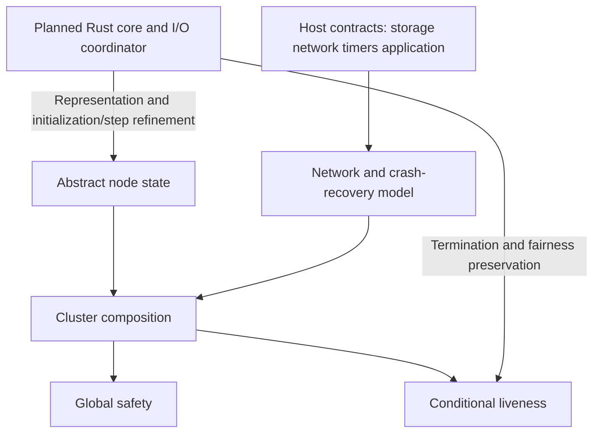

# DRAFT: model semantics and actual boundaries

The candidate entrypoint is `crates/raft-spec/src/lib.rs`. Status: **PARTIAL**; all 26 global Raft proof obligations are **OPEN**. It defines a transition relation, not an executable Raft implementation. No protocol-correctness axiom or top-level safety predicate was inserted into `next` guards. After authorized tool installation, actual Verus type/mode checking returned `0 verified, 0 errors`; this proves no Raft theorem.

Membership is a parameterized nonempty finite `Set<nat>`; `majority` is strict. Logs are internally zero-based; protocol indices start at 1, with index 0/term 0 as a sentinel, not an entry. `initial(members)` constructs a fresh cluster and `three_node_initial()` instantiates `{0,1,2}`. Recovery reads only the node's own `disk`, not arbitrary caller-supplied abstract state. Refinement to the host input of Rust `Event::Recover` remains open.

| State/action | Actual semantics | Obligations |
|---|---|---|
| `Node.hard/disk/pending_write` | Candidate memory image, durable image, one pending write; block protocol progress until acknowledgment | PO-IO, PO-RECOVERY |
| `election_timeout/send_vote` | Increase term and self-vote on expiry; send requests only after durability | PO-AUX-TERM, PO-AUX-VOTE |
| `higher_term` | Become follower and persist the new term before processing the same packet again | PO-AUX-TERM |
| `receive_vote_request/response` | Compare log freshness, one vote per term, Set deduplication; ignore stale-term responses | PO-S-ELECTION |
| `become_leader` | Record election permanently after a strict majority; append a current-term internal no-op | PO-S-ELECTION, PO-REQUEST |
| `introduce_request/propose` | Bind request identity to content; only a leader appends external requests; acceptance is not commitment | PO-REQUEST |
| `send_append` | Empty suffix heartbeat or multi-entry replication; retain peer/term/RPC-token association | PO-REFINE-STEP |
| `receive_append/merged` | Check previous index/term; truncate/append only at the first conflict or missing position; a short matching heartbeat preserves the tail | PO-S-LOG, PO-AUX-INDEX |
| `receive_append_response` | Only current-term/current-RPC responses update progress; success is monotonic; only matching failures backtrack | PO-AUX-TERM, PO-AUX-INDEX |
| `advance_commit` | A leader advances using majority-confirmed positions for a current-term entry, committing its prefix | PO-AUX-COMMIT, PO-S-COMPLETE |
| `storage_durable/storage_ack` | Durability and notification are separate, with crashes allowed between; successful responses wait for acknowledgment | PO-IO, PO-RECOVERY |
| `flush_message` | Observable transfer of an allowed outbox response to the network | PO-IO |
| `deliver` | Deliver the next committed, locally durable entry; at most one outstanding delivery | PO-DELIVERY, PO-S-INTERFACE |
| `application_performed/application_ack` | Under the optional application contract, atomically update application and durable cursor; acknowledge separately | PO-S-APPLY |
| `crash/recover/storage_error` | Lose volatile state, retain disk/application cursor; stop on uncertain storage failure; recovery increments incarnation | PO-RECOVERY, PO-AUX-TOKEN |
| `Drop/Duplicate`, arbitrary packet index | Loss, duplication, reordering; retaining messages and Stutter permit arbitrary delay | PO-COMPOSITION |
| `Tick`, deadline | External logical time and valid timeouts, without assuming an election result | PO-L-ELECTION |

Struct updates preserve unchanged fields explicitly. Network messages originate from actual model sends or exact duplicates. This relies on non-Byzantine identity/decoding and does not cover forgery. `commits` records prefixes at actual commit transitions, not hypothetical future permanence. Election, delivery and application histories survive crashes rather than examining only live nodes/current terms.

`election_safety`, `leader_append_only`, `log_matching`, `leader_completeness`, `delivery_consistency`, `application_safety` and `interface_safety` are predicates awaiting proof. Append-only restricts steps that start with a live leader and leave it alive. A higher term first causes a separate step-down; later follower steps may truncate legally. Changing role within one step cannot conceal deletion. Crash may discard a nondurable candidate tail; committed history remains subject to separate safety properties.

Application safety relies on the explicit host transaction/cursor contract. Delivery consistency does not provide arbitrary hosts with exactly-once effects. An entry delivered but not applied before a crash may be redelivered under a new incarnation; delivery indices strictly increase within an incarnation.

`valid_trace` is `init(ex(0)) ∧ ∀t. step(ex(t), actions(t), ex(t+1))`. The three `l_*` functions define quantified targets: a persistent same-term leader in the specified set, eventual commitment of a request, and eventual delivery of a committed entry to a specified node. Eligibility, stable majority, communication/processing, election opportunities and external term restrictions are not yet fully encoded as Verus premises. These are not liveness theorems or claims about every trace. `always/eventually_from/weak_fair` are transparent trace predicates, not a substitute axiom library for verus-tla. Permanent Stutter is allowed, so liveness cannot follow from init/next alone.

`observation_refines` equates only log, term and commit observations. Container views, coordinator state, cluster composition, visible intermediate I/O and exclusion of infinite internal spinning remain unproved. This projection cannot replace full implementation refinement.

## Refinement boundary

The local reconciliation correspondence uses the actual executable source and the existing `merged` definition. The wider arrows below remain planned obligations. The abstract transition model stays independent of executable code. The protected representation adapter in `crates/raft-spec/src/reconcile_view.rs` connects executable entry types to that model inside the proof entrypoint. Runtime Cargo builds erase those ghost references. No cyclic Cargo dependency or parallel Raft core is introduced.

## Explicit gaps and tool observations

1. **Local executable boundary:** `reconcile_log` uses `usize` predecessor positions and checked length arithmetic. A future handler must check conversion from protocol `u64`, predecessor/message terms, commit guards and persistence ordering. Rust `Vec` allocation failure may abort; this slice does not supply recoverable allocation failure or executable resource liveness. Actual local proof/build observations belong in the current review packet and `docs/tools.md`, not in model axioms.
2. **Temporal library BLOCKED:** upstream `verus_temporal_logic` and `defs.rs` APIs (`Execution/TempPred/always/eventually/weak_fairness`) were read, but no compatible Verus/vstd/Rust integration was installed or verified. See [sources](../docs/sources.md); no fabricated pin.
3. **Interface formalization PARTIAL:** Rust types cover timer generations, send completions, errors and unknown/duplicate completions. The model expands storage/application success, stopping on storage failure and ignoring old incarnations. Same-incarnation unknown/duplicate tokens, timer generations, malformed-message rejection and error returns need a concrete interface state machine. Invalid inputs cannot silently succeed.
4. **Retry/scheduling PARTIAL:** resending AppendEntries replaces that peer's current RPC. Late failures do not backtrack progress, but liveness must prevent sends from continually displacing every useful response. Unlimited duplication of old same-term heartbeats can suppress elections; finite duplication/draining and outside-Q interference restrictions are necessary beyond higher-term limits. Cancellation, retry scheduling and resource fairness remain unformalized.
5. **Resources PARTIAL:** spec `nat/Seq/Map` are not Rust `u64/Vec`. Recommend checked overflow/capacity and ResourceExhausted; safe stopping is not liveness. Operation-token allocation checks and local reconciliation index/length checks are implemented. Handler-wide terms/indices, allocation failure and durable incarnation freshness remain to implement.
6. **Induction/refinement OPEN:** no proof that Init/Next preserve protocol invariants or imply S/L targets; no actual Raft handler, simulator, cluster composition or infinite-trace liveness-preservation proof.

The library now exposes local log reconciliation as well as the candidate types and token helper. The installed-Verus build path checks and compiles the same reconciliation source used by the runtime tests, replay and microbenchmark; see [workflow.md](../docs/workflow.md). The local proof entrypoint is `crates/raft-proofs/reconcile.rs`. Full Raft remains incomplete. Cargo test success and a local operation theorem do not establish cluster safety or liveness.

See [tool setup](../docs/tools.md) for recorded commands, installation and provenance. This file describes model semantics and gaps only.
