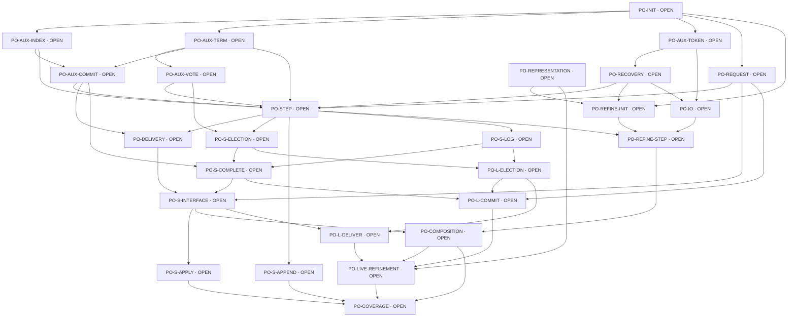

# Raft proof checklist

Status: DRAFT. Every global obligation below is OPEN. Local operation proofs have a separate, bounded meaning; no local result completes the cluster safety/liveness claim.

Read requirements.md, properties.md, assumptions.md, io.md and trust.md for target definitions, assumptions and TCB. This checklist is the source for dependency and coverage checks. Edit plain Markdown; no separate JSON registry is maintained. Lists within table cells are comma-separated; use `-` for an empty list.

## Obligations

| ID | Status | Goal | Depends | Assumptions | TCB | Source | Symbols | Decisions |
|---|---|---|---|---|---|---|---|---|
| PO-INIT | OPEN | A legal fresh-cluster instance exists; every init state establishes the candidate inductive invariant. | - | - | TCB-VERUS, TCB-VSTD, TCB-SMT | crates/raft-spec/src/lib.rs | init, well_formed | ADR-02 |
| PO-AUX-INDEX | OPEN | Log sentinels, one-based indices, commit/deliver/apply bounds and slicing preserve valid domains. | PO-INIT | - | TCB-VERUS, TCB-VSTD, TCB-SMT | crates/raft-spec/src/lib.rs | well_formed | ADR-03 |
| PO-AUX-TERM | OPEN | Terms are monotonic; late or cross-term responses cannot incorrectly update votes or replication progress. | PO-INIT | A-S-ID, A-S-STORAGE, A-S-COMPLETION | TCB-VERUS, TCB-VSTD, TCB-SMT | crates/raft-spec/src/lib.rs | next, well_formed | ADR-01 |
| PO-AUX-VOTE | OPEN | At most one vote per term, persisted before sending; count unique members; grant votes only to sufficiently up-to-date candidates; establish quorum intersection. | PO-AUX-TERM | A-S-ID, A-S-STORAGE, A-S-COMPLETION | TCB-VERUS, TCB-VSTD, TCB-SMT | crates/raft-spec/src/lib.rs | next, well_formed | ADR-02, ADR-07 |
| PO-AUX-COMMIT | OPEN | A leader advances commit directly only through a current-term entry durably matched by a majority; prefix commitment must not circularly assume completeness. | PO-AUX-INDEX, PO-AUX-TERM | A-S-ID, A-S-STORAGE, A-S-COMPLETION | TCB-VERUS, TCB-VSTD, TCB-SMT | crates/raft-spec/src/lib.rs | next, well_formed | ADR-07 |
| PO-AUX-TOKEN | OPEN | Operation tokens are unique within an incarnation and cannot be reused across recovery; duplicate, stale and unknown notifications must still be filtered independently of completion authenticity. | PO-INIT | A-S-ID, A-S-STORAGE, A-S-COMPLETION | TCB-VERUS, TCB-VSTD, TCB-SMT | crates/raft-verified/src/lib.rs | next | ADR-01, ADR-03 |
| PO-REQUEST | OPEN | Client entries originate from actual valid proposals; identity and command remain stable; NoOp cannot impersonate a request and Accepted cannot impersonate commitment. | PO-INIT | A-S-ID, A-S-STORAGE, A-S-COMPLETION | TCB-VERUS, TCB-VSTD, TCB-SMT | crates/raft-spec/src/lib.rs | next | ADR-05 |
| PO-RECOVERY | OPEN | Crashes discard volatile and pending state; recovery preserves acknowledged durable state and history. New incarnations filter old callbacks; recovery cannot start from arbitrary corrupt state. | PO-AUX-TOKEN | A-S-ID, A-S-STORAGE, A-S-COMPLETION | TCB-VERUS, TCB-VSTD, TCB-SMT | crates/raft-spec/src/lib.rs | init, next | ADR-06, ADR-07 |
| PO-STEP | OPEN | The candidate Inv includes protocol invariants beyond structural well_formed; every Next branch preserves all auxiliary protocol invariants. | PO-AUX-INDEX, PO-AUX-TERM, PO-AUX-VOTE, PO-AUX-COMMIT, PO-RECOVERY, PO-REQUEST | A-S-ID, A-S-STORAGE, A-S-COMPLETION | TCB-VERUS, TCB-VSTD, TCB-SMT | crates/raft-spec/src/lib.rs | next, well_formed | - |
| PO-DELIVERY | OPEN | Deliver in order only within commit; recovery replay is permitted; delivery history agrees on the command at each position. | PO-STEP, PO-AUX-COMMIT | A-S-ID, A-S-STORAGE, A-S-COMPLETION | TCB-VERUS, TCB-VSTD, TCB-SMT | crates/raft-spec/src/lib.rs | delivery_consistency, interface_safety | ADR-06 |
| PO-S-ELECTION | OPEN | At most one historically elected leader per term. | PO-STEP, PO-AUX-VOTE | A-S-ID, A-S-STORAGE, A-S-COMPLETION | TCB-VERUS, TCB-VSTD, TCB-SMT | crates/raft-spec/src/lib.rs | election_safety | - |
| PO-S-APPEND | OPEN | A leader's own log is append-only during a continuous leader interval; legal follower truncation is not restricted. | PO-STEP | A-S-ID, A-S-STORAGE, A-S-COMPLETION | TCB-VERUS, TCB-VSTD, TCB-SMT | crates/raft-spec/src/lib.rs | leader_append_only | - |
| PO-S-LOG | OPEN | Entries with the same index and term have identical prefixes. | PO-STEP | A-S-ID, A-S-STORAGE, A-S-COMPLETION | TCB-VERUS, TCB-VSTD, TCB-SMT | crates/raft-spec/src/lib.rs | log_matching | - |
| PO-S-COMPLETE | OPEN | Every historically committed entry is present in each leader elected in a later term. | PO-S-LOG, PO-S-ELECTION, PO-AUX-COMMIT | A-S-ID, A-S-STORAGE, A-S-COMPLETION | TCB-VERUS, TCB-VSTD, TCB-SMT | crates/raft-spec/src/lib.rs | leader_completeness | - |
| PO-S-INTERFACE | OPEN | Deliver only committed prefixes, with consistent historical contents and correct error/ordering semantics. | PO-S-COMPLETE, PO-DELIVERY, PO-REQUEST | A-S-ID, A-S-STORAGE, A-S-COMPLETION | TCB-VERUS, TCB-VSTD, TCB-SMT | crates/raft-spec/src/lib.rs | interface_safety | - |
| PO-S-APPLY | OPEN | Under A-S-APP, different nodes and crash-recovery episodes never apply different commands at the same logical position. | PO-S-INTERFACE | A-S-ID, A-S-STORAGE, A-S-COMPLETION, A-S-APP | TCB-VERUS, TCB-VSTD, TCB-SMT, TCB-APPLICATION | crates/raft-spec/src/lib.rs | application_safety | ADR-06 |
| PO-REPRESENTATION | OPEN | Map Rust containers, numbers and messages to mathematical state; checked overflow and allocation failure correspond to explicit errors; establish entry preconditions. | - | A-P-MACHINE | TCB-VERUS, TCB-VSTD, TCB-SMT, TCB-RUST | crates/raft-verified/src/lib.rs | well_formed | ADR-03 |
| PO-REFINE-INIT | OPEN | Actual creation and recovery produce permitted abstract states and correct output effects. | PO-INIT, PO-REPRESENTATION, PO-RECOVERY | A-S-ID, A-S-STORAGE, A-S-COMPLETION, A-P-MACHINE | TCB-VERUS, TCB-VSTD, TCB-SMT | crates/raft-verified/src/lib.rs | init | ADR-01, ADR-07 |
| PO-IO | OPEN | Send/Persist/Deliver, callbacks and errors have observable abstract counterparts; crash-visible I/O cannot be hidden as stuttering. | PO-AUX-TOKEN, PO-RECOVERY | A-S-ID, A-S-STORAGE, A-S-COMPLETION | TCB-VERUS, TCB-VSTD, TCB-SMT | crates/raft-verified/src/lib.rs | next | ADR-01, ADR-06, ADR-07 |
| PO-REFINE-STEP | OPEN | Every executable event branch maps to a legal abstract step or finite sequence, including errors and internal steps. | PO-REFINE-INIT, PO-IO, PO-STEP | A-S-ID, A-S-STORAGE, A-S-COMPLETION, A-P-MACHINE | TCB-VERUS, TCB-VSTD, TCB-SMT | crates/raft-verified/src/lib.rs | next | ADR-01 |
| PO-COMPOSITION | OPEN | Actual nodes and host/network/fault interleavings jointly form valid_trace; local postconditions do not automatically establish a cluster theorem. | PO-REFINE-STEP, PO-S-INTERFACE | A-S-ID, A-S-STORAGE, A-S-COMPLETION | TCB-VERUS, TCB-VSTD, TCB-SMT | crates/raft-proofs/README.md | valid_trace | ADR-07 |
| PO-L-ELECTION | OPEN | From every allowed reachable start, non-circular election conditions eventually yield a persistent leader able to make progress; account for higher-term interference from outside Q. | PO-S-ELECTION, PO-S-LOG | A-S-ID, A-S-STORAGE, A-S-COMPLETION, A-L-STABLE, A-L-NETWORK, A-L-OPPORTUNITY, A-L-TERM, A-L-HOST, A-L-IO | TCB-VERUS, TCB-VSTD, TCB-SMT | crates/raft-spec/src/lib.rs | valid_trace, l_election | ADR-04, ADR-08 |
| PO-L-COMMIT | OPEN | Every valid, persistently retried and fairly served request eventually has at least one corresponding Client entry committed; Accepted alone does not imply success. | PO-L-ELECTION, PO-S-COMPLETE, PO-REQUEST | A-S-ID, A-S-STORAGE, A-S-COMPLETION, A-L-STABLE, A-L-NETWORK, A-L-OPPORTUNITY, A-L-TERM, A-L-HOST, A-L-IO, A-L-REQUEST | TCB-VERUS, TCB-VSTD, TCB-SMT | crates/raft-spec/src/lib.rs | valid_trace, l_commit | ADR-04, ADR-05, ADR-08 |
| PO-L-DELIVER | OPEN | Each committed position is eventually delivered in order to every continuously participating Q node satisfying the environmental conditions; permanently failed nodes are excluded. | PO-L-ELECTION, PO-S-INTERFACE | A-S-ID, A-S-STORAGE, A-S-COMPLETION, A-L-STABLE, A-L-NETWORK, A-L-OPPORTUNITY, A-L-TERM, A-L-HOST, A-L-IO | TCB-VERUS, TCB-VSTD, TCB-SMT | crates/raft-spec/src/lib.rs | valid_trace, l_deliver | ADR-04, ADR-06, ADR-08 |
| PO-LIVE-REFINEMENT | OPEN | Exclude infinite internal stuttering; prove call termination, correspondence of external waits and fairness, and finite resource budgets to transfer abstract progress to executable code. | PO-COMPOSITION, PO-L-COMMIT, PO-L-DELIVER, PO-REPRESENTATION | A-S-ID, A-S-STORAGE, A-S-COMPLETION, A-L-STABLE, A-L-NETWORK, A-L-OPPORTUNITY, A-L-TERM, A-L-HOST, A-L-IO, A-L-REQUEST, A-P-MACHINE, A-P-CAPACITY, A-P-CLOCK | TCB-VERUS, TCB-VSTD, TCB-SMT | crates/raft-verified/src/lib.rs, crates/raft-proofs/README.md | valid_trace, l_election, l_commit, l_deliver | ADR-03, ADR-04, ADR-09 |
| PO-COVERAGE | OPEN | Actual executable entrypoints, all event/error/Next branches, nine top-level properties and composition theorems participate in the same controlled full check; no unresolved trust entries or skipped entrypoints. | PO-COMPOSITION, PO-S-APPEND, PO-S-APPLY, PO-LIVE-REFINEMENT | - | TCB-VERUS, TCB-VSTD, TCB-SMT, TCB-CHECKER | crates/raft-spec/src/lib.rs, crates/raft-verified/src/lib.rs, crates/raft-proofs/README.md | init, next, valid_trace, election_safety, leader_append_only, log_matching, leader_completeness, interface_safety, application_safety, l_election, l_commit, l_deliver | ADR-08, ADR-09, ADR-10 |

## Additional coverage

Every obligation row covers its listed source/symbols under the full profile. The following additional entries retain branch/interface coverage. They are all OPEN. Definition checks do not prove preservation or refinement.

| ID | Obligations | Source | Symbols | Checks |
|---|---|---|---|---|
| BRANCH-election_timeout | PO-AUX-TERM, PO-AUX-VOTE | crates/raft-spec/src/lib.rs | election_timeout | spec, full |
| BRANCH-send_vote | PO-AUX-VOTE | crates/raft-spec/src/lib.rs | send_vote | spec, full |
| BRANCH-higher_term | PO-AUX-TERM | crates/raft-spec/src/lib.rs | higher_term | spec, full |
| BRANCH-receive_vote_request | PO-AUX-VOTE | crates/raft-spec/src/lib.rs | receive_vote_request | spec, full |
| BRANCH-receive_vote_response | PO-AUX-VOTE | crates/raft-spec/src/lib.rs | receive_vote_response | spec, full |
| BRANCH-become_leader | PO-S-ELECTION | crates/raft-spec/src/lib.rs | become_leader | spec, full |
| BRANCH-introduce_request | PO-REQUEST | crates/raft-spec/src/lib.rs | introduce_request | spec, full |
| BRANCH-propose | PO-REQUEST, PO-S-APPEND | crates/raft-spec/src/lib.rs | propose | spec, full |
| BRANCH-send_append | PO-S-LOG | crates/raft-spec/src/lib.rs | send_append | spec, full |
| BRANCH-receive_append | PO-S-LOG, PO-S-COMPLETE | crates/raft-spec/src/lib.rs | receive_append | spec, full |
| BRANCH-receive_append_response | PO-AUX-TERM, PO-AUX-COMMIT | crates/raft-spec/src/lib.rs | receive_append_response | spec, full |
| BRANCH-advance_commit | PO-AUX-COMMIT | crates/raft-spec/src/lib.rs | advance_commit | spec, full |
| BRANCH-storage_durable | PO-IO, PO-RECOVERY | crates/raft-spec/src/lib.rs | storage_durable | spec, full |
| BRANCH-storage_ack | PO-IO, PO-AUX-TOKEN | crates/raft-spec/src/lib.rs | storage_ack | spec, full |
| BRANCH-flush_message | PO-IO | crates/raft-spec/src/lib.rs | flush_message | spec, full |
| BRANCH-deliver | PO-DELIVERY | crates/raft-spec/src/lib.rs | deliver | spec, full |
| BRANCH-application_performed | PO-S-APPLY | crates/raft-spec/src/lib.rs | application_performed | spec, full |
| BRANCH-application_ack | PO-AUX-TOKEN, PO-S-APPLY | crates/raft-spec/src/lib.rs | application_ack | spec, full |
| BRANCH-crash | PO-RECOVERY | crates/raft-spec/src/lib.rs | crash | spec, full |
| BRANCH-recover | PO-RECOVERY | crates/raft-spec/src/lib.rs | recover | spec, full |
| BRANCH-storage_error | PO-RECOVERY | crates/raft-spec/src/lib.rs | storage_error | spec, full |
| BRANCH-stale_completion | PO-AUX-TOKEN | crates/raft-spec/src/lib.rs | stale_completion | spec, full |
| BRANCH-step | PO-STEP, PO-COMPOSITION | crates/raft-spec/src/lib.rs | step | spec, full |

## Completion limits

- The executable reconciliation operation is a local building block. No complete node/event coordinator exists; its local proof does not replace full handler or cluster refinement.
- Verify all actual entrypoints, event/error branches, build configuration and transitive dependencies. Counts alone do not establish symbol coverage.
- Tick, Stutter, Drop and Duplicate are part of step; arbitrary packet consumption models reordering and retention models delay.
- Full acceptance requires all obligations, including liveness and refinement. Do not delete targets to obtain a pass.
- Bounded tasks and missing milestone prerequisites are described in [roadmap.md](roadmap.md).

## Dependency graph

## Refinement requirements

Internal L-COMMIT lemmas may use a stable leader, but the top-level chain must first derive L-ELECTION from non-circular premises. Natural-language timing/opportunity conditions must be related individually to model trace predicates. Missing parts remain PARTIAL/OPEN. A state machine, temporal predicate or successful trace alone is not a liveness proof.

Full claims also need PO-COMPOSITION to combine local correspondences into an actual cluster execution, PO-LIVE-REFINEMENT to exclude infinite unobservable internal stuttering and preserve fairness, and PO-COVERAGE to cover all formal entrypoints/branches. A handler's postcondition alone establishes only a local result.

## Local reconciliation result

`LOCAL-RECONCILE` means that the executable `reconcile_log` in `crates/raft-verified/src/reconcile.rs` meets its bounds/error contract and corresponds to the existing `merged` relation. The proof entrypoint is `crates/raft-proofs/reconcile.rs`; its selected profile and expected targets are execution metadata in `workflow.toml`. Actual tool output supplies the result, not this prose or the presence of a function name.

This result preserves the prefix before replacement and the tail of an empty or shorter matching request. Term equality is the model's matching test, so the operation retains old command contents for equal-term overlaps even if incoming contents differ. It does not prove that such different contents are reachable or establish global log matching. Future handlers must establish their message-term, predecessor-term, commit and durability guards. No new environmental assumption is needed merely to describe this local operation.

A successful local proof contributes to later PO-AUX-INDEX, PO-REPRESENTATION and PO-REFINE-STEP work; it closes none of their complete obligations. The specification stays DRAFT even if this local theorem is actually checked. Human approval, local checking and full coverage are different facts.

## Requirement-to-source map

Formal definitions remain in source; this map points to them rather than redefining the mathematics in task prose. All cluster definitions below are in `crates/raft-spec/src/lib.rs` unless stated otherwise. Intended global proofs are unfinished.

| Requirement | Formal definition | Intended proof / present boundary |
|---|---|---|
| Reconcile at the first conflicting or missing entry; preserve a matching tail | `merged`; executable contract in `crates/raft-verified/src/reconcile.rs` | `crates/raft-proofs/reconcile.rs`, LOCAL-RECONCILE; only this operation |
| One historical elected leader per term | `election_safety` | PO-S-ELECTION, using term/vote and quorum invariants |
| A continuing leader preserves its existing log | `leader_append_only` | PO-S-APPEND, using the relevant transition cases |
| Equal index/term implies equal prefixes | `log_matching` | PO-S-LOG, using an inductive log invariant |
| Later leaders retain earlier committed entries | `leader_completeness` | PO-S-COMPLETE, with vote freshness and current-term commitment |
| Ordered consistent committed delivery and honest errors | `delivery_consistency`, `interface_safety` | PO-DELIVERY and PO-S-INTERFACE, plus executable I/O refinement |
| Consistent host application by log position | `application_safety` | PO-S-APPLY under A-S-APP |
| Eventually a persistent leader under stated conditions | `valid_trace`, `l_election` | PO-L-ELECTION; environmental predicate encoding and proof still missing |
| Every eligible retried request eventually commits | `valid_trace`, `l_commit` | PO-L-COMMIT after election progress and fair request service |
| Each eligible committed position is eventually delivered | `valid_trace`, `l_deliver` | PO-L-DELIVER after replication and delivery service |
| Real executions preserve model safety and progress | `observation_refines`, `step`, `valid_trace` plus future executable views | PO-REPRESENTATION, PO-IO, PO-REFINE-STEP, PO-COMPOSITION, PO-LIVE-REFINEMENT; the observation projection alone is insufficient |

## Regression work

The runnable task sequence and the old-to-new task mapping are in [roadmap.md](roadmap.md). The first replay uses only the local reconciliation operation; the broader scenario coverage below is planned.

A future deterministic simulator must use the same executable core and control clocks, messages and I/O completions through an event queue. Record seeds and event sequences. Property tests must cover 1/3/5 nodes, varied finite identities, retry/replay, partition healing, lost/duplicate/late messages, crashes around every persistence boundary, disk failure, unknown senders, wrong-incarnation completions, duplicate acknowledgments, indices and u64 limits. These Raft simulations have not been run.

| Mutation or failure | Property/obligation that must expose it |
|---|---|
| Count duplicate votes toward a quorum | PO-AUX-VOTE → S-ELECTION |
| Ignore log freshness when voting | PO-AUX-VOTE → S-COMPLETE |
| Commit an old-term majority entry directly | PO-AUX-COMMIT → S-COMPLETE/S-INTERFACE |
| Send a positive response before persistence | PO-IO/PO-RECOVERY → S-ELECTION/S-LOG |
| Late append success incorrectly advances match | PO-AUX-TERM/PO-REFINE-STEP → S-COMPLETE |
| Reuse incarnation/token | PO-AUX-TOKEN/PO-RECOVERY → S-INTERFACE |
| Deliver beyond commit or skip prior positions | PO-DELIVERY → S-INTERFACE/S-APPLY |
| Stable majority but endless external term increases | PO-L-ELECTION; must violate explicit A-L-TERM, not be silently ignored |
| New proposals starve old requests; internal spinning | PO-L-COMMIT/PO-LIVE-REFINEMENT |

Differential tests compare permitted external semantics/traces, not identical message sequences. Tests expose counterexamples/regressions; they do not replace proofs for arbitrary finite sizes and infinite traces. Positive/negative proof smoke checks close none of these Raft obligations.

The draft LOCAL-NODE-INIT target checks `Node::new` against the represented fields of `fresh_node`, including success on every valid membership. Its protected consumer is `crates/raft-proofs/node_init.rs`; it imports the exact runtime source. A passing candidate does not close PO-INIT, PO-REPRESENTATION or PO-REFINE-INIT: cluster construction, peer state and whole-node refinement are absent; initialized pending I/O is now included. See STATE-INIT for the executable assignment and its independent checks.

LOCAL-PERSIST and LOCAL-PERSIST-VIEW check the actual coordinator and its storage projection, including exact successful callback release and no release for wrong-kind/stale/unknown completions. The same partial dispatcher is exercised by the host driver. LOCAL-PROGRESS checks eventual release after fair service of a successful notification with explicit noninterference and actual dispatcher-step premises. These local targets discharge none of the global rows above: legal protocol callers, durable host behavior, recovery, full message/effect refinement, resources and global fairness transfer remain OPEN.
