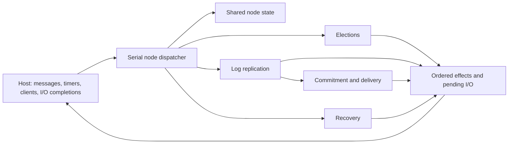

# Building the complete Raft library

Status: DRAFT. Every module is INCOMPLETE. Module assignments describe the complete destination; a controller call selects one bounded step inside a module. All requirements, assumptions and semantic decisions keep their existing review status.

## Modules and their connections

| Assignment | Complete responsibility | Current implementation |
|---|---|---|
| [state.md](state.md) | Shared node representation, membership, initialization and state invariants | Observable vocabulary, editable representation/local-contract seeds and independent checks; constructor awaits generation |
| [runtime.md](runtime.md) | Serial event dispatch, persistence/completion ordering and timer/effect coordination | Coordinator/dispatcher signatures and failing seeds, independent checks and deterministic host driver; behavior awaits generation |
| [elections.md](elections.md) | Timeouts, vote requests/responses, quorum counting, leadership and step-down | Missing |
| [replication.md](replication.md) | Leader proposals/heartbeats/retries, follower append, responses and peer progress | Reconciliation signature and failing seed, with local targets/tests/replay; behavior awaits generation |
| [commitment.md](commitment.md) | Durable-majority commit advancement and ordered delivery/application acknowledgment | Missing |
| [recovery.md](recovery.md) | Crash reconstruction, stale-event handling and deterministic cluster fault histories | Full recovery/fault driver missing |
| [progress.md](progress.md) | Conditional election, request-commit and delivery liveness, transferred to executable code | Early coordinator trace/progress targets with empty proof bodies; global theorems and fairness transfer remain open |
| [integration.md](integration.md) | Runnable cluster/adapters, global safety/refinement, measurements and complete-project review | Core microbenchmark and local checking workflow only |

Each document states module behavior, interfaces to other modules, completion criteria and implementation/proof/test steps. Formal definitions remain in Verus source. The global obligations in [proofs.md](proofs.md) span modules; they are not a replacement for an implementation plan.

Modules are organizational boundaries. At runtime, a node has one coupled state machine: changing a term or role affects outstanding replication; changing a log constrains commit/delivery; recovery affects every pending token and timer. Shared invariants must survive the complete event/I/O sequence. Local contracts require their callers to establish the preconditions, and node/cluster refinement must connect all paths. Development dependencies describe the order of constructing code and proofs, not independent runtime services or a proof that behavior is acyclic. Relevant cross-module tests and dependent proofs accompany each change.

The architecture below is the intended destination; data types and interfaces are supplied, while executable behavior must be generated:

## Execution and completion

Read the module document, then choose its configured step. `workflow.toml` selects the document and exact `## Step: ...` heading using `module` and `step`. The prompt contains the shared module responsibility/completion context and only the selected step's assignment. Editable scope, prerequisites, checks and budgets still come from TOML. No task is asked to finish an entire module in one unbounded call.

`python3 -m orchestrator plan --format text` displays modules and steps together. Ready means local work has real scope/checks; planned means named prerequisites or checks are missing. Neither status is permission for real Codex generation. `run-plan` expands configured prerequisites and executes selected steps serially in one candidate. Its PASSED result concerns those steps only. Module completion is NOT_ASSESSED by the controller; a human reviews the module's full criteria and actual coverage. Full project acceptance still requires every safety/liveness and refinement obligation, approved semantics and the existing execution protections.

Read [the experimental starting point](starting-point.md). The default experiment selects STATE-INIT: generate the shared-node constructor, representation, local contracts and proof, then run its independent tests, initial-state replay, actual Verus checks and construction measurements. The source seed is intentionally rejected; a fixture-generated passing candidate is only an offline workflow test. Four optional ready steps generate, prove, replay and measure reconciliation. None of these completes a module, cluster safety or conditional liveness.

Select RUNTIME-PERSIST to carry a checked STATE-INIT candidate directly into the coordinator in one plan; integration into the source checkout is not a prerequisite. PROGRESS-FOUNDATION follows the coordinator before global safety integration. Continue growing that same Node through elections, both-side replication, commit/delivery and recovery. Develop each executable change with its view, invariants, tests and local proofs; implementation and proof are not separate phases. Integrate the growing dispatcher as handlers arrive. Tasks without real checks remain planned. IDS guides this method (docs/sources.md, S14); no full IDS agent framework is imported.

## Previous task identifiers

The old standalone files have been removed; existing evidence keeps its original identifiers. New commands use the module-oriented IDs below. Old saved runs remain readable but are not silently remapped or resumed under changed task definitions.

| Previous task | Current location / step |
|---|---|
| T01-RECONCILE | replication.md / REPLICATION-RECONCILE |
| T02-RECONCILE-PROOF | replication.md / REPLICATION-PROOF |
| T03-REPLAY | replication.md / REPLICATION-REPLAY |
| T04-MEASURE | integration.md / INTEGRATION-MEASURE |
| T05-VOTE | elections.md / ELECTION-VOTE, within the complete election lifecycle |
| T06-FOLLOWER-APPEND | replication.md / REPLICATION-FOLLOWER, alongside leader send/response work |
| T07-COMMIT | commitment.md / COMMITMENT-ADVANCE, alongside delivery/acknowledgment |
| T08-ELECTION-PROGRESS | progress.md / PROGRESS-ELECTION, followed by commitment/delivery/refinement |

Earlier bootstrap categories map as follows: T01-MODEL and T02-REFINE-INIT belong to state/model work; T03-REFINE-STEP spans runtime and protocol modules; T04-SAFETY feeds integration's invariant/composition work; T05-ELECTION, T06-PROGRESS and T07-LIVE-REFINE belong to progress; T08-INTEGRATION belongs to recovery/integration. The original global obligation IDs and dependency graph remain unchanged.
