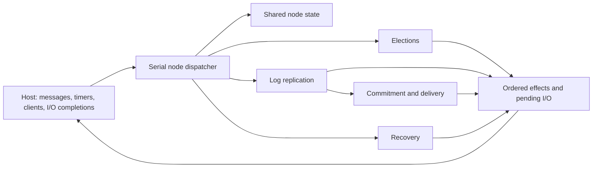

# Building the complete Raft library

Status: DRAFT. Every module is INCOMPLETE. Module assignments describe the complete destination; the active MadSim extension steps are described below and a controller call selects one bounded step inside a module. All requirements, assumptions and semantic decisions keep their existing review status.

## Modules and their connections

| Assignment | Complete responsibility | Current implementation |
|---|---|---|
| [state.md](state.md) | Shared node representation, membership, initialization and state invariants | Observable vocabulary, editable representation/local-contract seeds and independent checks; the single shared Node::new awaits generation |
| [runtime.md](runtime.md) | Serial event dispatch, persistence/completion ordering and timer/effect coordination | Real host supplied; persistence coordination and public event dispatcher await generation |
| [elections.md](elections.md) | Timeouts, vote requests/responses, quorum counting, leadership and step-down | RequestVote, durable replies and election lifecycle await generation |
| [replication.md](replication.md) | Leader proposals/heartbeats/retries, follower append, responses and peer progress | Reconciliation signature and failing seed, with local targets/tests/replay; behavior awaits generation |
| [commitment.md](commitment.md) | Durable-majority commit advancement and ordered delivery/application acknowledgment | Missing |
| [recovery.md](recovery.md) | Crash reconstruction, stale-event handling and deterministic cluster fault histories | Recovery behavior missing; real host and repeatable fault scenarios supplied |
| [progress.md](progress.md) | Conditional election, request-commit and delivery liveness, transferred to executable code | Early coordinator trace/progress targets with empty proof bodies; global theorems and fairness transfer remain open |
| [integration.md](integration.md) | Runnable cluster/adapters, global safety/refinement, measurements and complete-project review | Real cluster host, independent tests and local checks; complete-execution/global proof consumers missing |

Each document states module behavior, interfaces to other modules, completion criteria and implementation/proof/test steps. Formal definitions remain in Verus source. The global obligations in [proofs.md](proofs.md) span modules; they are not a replacement for an implementation plan.

Modules are organizational boundaries. At runtime, a node has one coupled state machine: changing a term or role affects outstanding replication; changing a log constrains commit/delivery; recovery affects every pending token and timer. Shared invariants must survive the complete event/I/O sequence. Local contracts require their callers to establish the preconditions, and node/cluster refinement must connect all paths. Development dependencies describe the order of constructing code and proofs, not independent runtime services or a proof that behavior is acyclic. Relevant cross-module tests and dependent proofs accompany each change.

The architecture below is the intended destination; data types and interfaces are supplied, while executable behavior must be generated:

## Execution and completion

Read the module document, then choose its configured step. `workflow.toml` selects the document and exact `## Step: ...` heading using `module` and `step`. The prompt contains the shared module responsibility/completion context and only the selected step's assignment. Editable scope, prerequisites, checks and budgets still come from TOML. No task is asked to finish an entire module in one unbounded call.

`python3 -m orchestrator plan --format text` displays modules and steps together. Ready means local work has real scope/checks; planned means named prerequisites or checks are missing. Neither status is permission for real Codex generation. `run-plan` expands configured prerequisites and executes selected steps serially in one candidate. Its PASSED result concerns those steps only. Module completion is NOT_ASSESSED by the controller; a human reviews the module's full criteria and actual coverage. Full project acceptance still requires every safety/liveness and refinement obligation, approved semantics and the existing execution protections.

Every new experiment starts from [the supplied foundation](starting-point.md) in a new directory; resume is explicit and keeps only that experiment's work. The default launcher selects MADRAFT-RECOVERY and expands STATE-INIT → RUNTIME-PERSIST → MADRAFT-VOTE → MADRAFT-ELECTION → MADRAFT-REPLICATION → MADRAFT-RECOVERY. Python invokes Codex for each bounded assignment and repairs the same candidate using actual checker feedback. The controller, not this maintenance session, records the generated protocol code and proofs. STATE-INIT and RUNTIME-PERSIST are reused as default prerequisites, so initialization and persistence are generated within this experiment. Reconciliation also remains available as an explicit local experiment.

The four new steps have real local test/proof profiles and reuse the existing cumulative budgets and regression handling. Their passing result is SELECTED_STEPS_ONLY. Whole-execution refinement and independent five-property proof consumers are still missing, so INTEGRATION-SAFETY remains planned and raft-safety reports BLOCKED. Conditional liveness and concrete progress refinement remain mandatory, unfinished acceptance requirements. This limitation is explicit rather than silently accepting handler proofs as complete safety.
